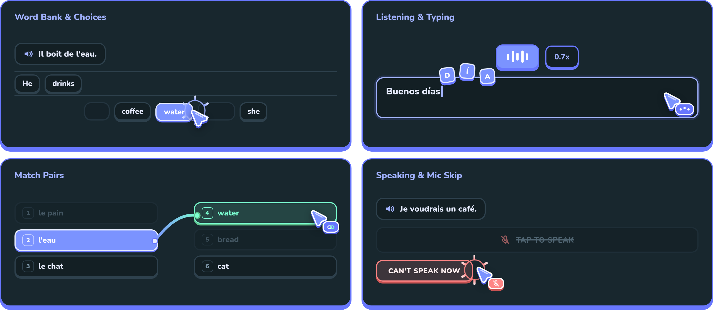
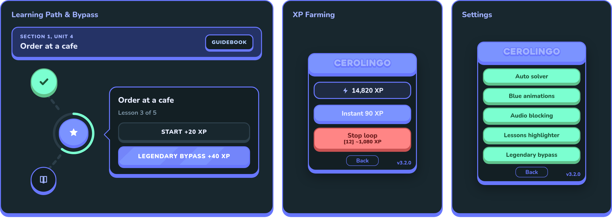

  
  
  

  
  

  
  &nbsp;
  

**Cerolingo** is a free, open-source browser extension for automating Duolingo lessons, stories, Duo Radio, practice sessions, and XP progression directly inside the web interface.

Most Duolingo auto-solvers lock core features behind paid plans, subscriptions, accounts, or closed obfuscated code. Cerolingo takes the opposite approach: every feature is free forever, the entire codebase is open under GPLv3, and the extension collects zero data.

## Why Cerolingo?

| Feature | Cerolingo | Typical Paid / Closed Solvers |
| --- | --- | --- |
| **Price** | 100% free forever | Subscriptions, pro tiers, or feature locks |
| **Source code** | Open source (GPLv3), readable on GitHub | Closed or obfuscated builds |
| **Permissions** | Only `storage` (local settings) | Broad permissions, logins, or remote APIs |
| **Telemetry & tracking** | None (`data_collection: none`) | External servers, license checks, analytics |
| **Platforms** | Chrome, Chromium browsers, Firefox Desktop & Android | Usually desktop Chrome only |

## Features

- **Auto Solver**: Auto-answers standard path lessons, stories, Duo Radio, and practice sessions. Handles word banks, translation typing, fill-in-the-blank, multiple choice, text and audio match pairs, listening prompts, and speaking skips.
- **Per-Action Blue Animations**: Visual feedback for each action, including a 3D pointer glide, starburst taps, curved match-pair links, floating 3D keycaps while typing, audio equalizer indicators, and mic-skip badges. Cleans up automatically after each step and can be turned off in Settings.
- **Auto-Path & Lesson Loop**: Walks through your learning path hands-free or repeats a saved story lesson automatically with built-in loop guards.
- **XP Farming**: Grants story XP directly from the in-page menu (single run or continuous loop) while showing your live Total XP counter.
- **Audio Blocking**: Speeds up listening clips and skips spoken dialogue delays in stories and Duo Radio.
- **Lessons Highlighter**: Highlights supported story, Duo Radio, and path nodes in Cerolingo blue on the learning map.
- **Legendary Bypass**: Adds a `Legendary Bypass +40 XP` shortcut directly inside level popovers on the path.
- **In-Page Mod Menu**: Draggable, minimizable overlay built right into Duolingo. Works on desktop browsers and Firefox for Android across `duolingo.com` and `duolingo.cn`.

## Quick Start

1. Install Cerolingo from the [Chrome Web Store](https://chromewebstore.google.com/detail/cerolingo/apgkphplddmjkoogmoijendkdjaaeiii) (works on Chrome, Brave, Edge, Opera, Vivaldi, and Arc) or [Firefox Add-ons](https://addons.mozilla.org/firefox/addon/cerolingo/) (desktop and Firefox for Android).
2. Open [duolingo.com](https://www.duolingo.com) (or `duolingo.cn`). The Cerolingo Mod Menu appears in the bottom-right corner.
3. Drag the menu anywhere on the screen, or click the top **CEROLINGO** bar to minimize or expand it.
4. Start any lesson or story and let **Auto solver** handle the exercises, or open **Lesson loop** to run **Auto-Path** across your tree.
5. Before using **Lesson loop** or **XP Farming** for the first time, complete one story lesson so Cerolingo can save the required story ID and URL locally.
6. Open **Settings** inside the menu to toggle individual modules (`Auto solver`, `Blue animations`, `Audio blocking`, `Lessons highlighter`, `Legendary bypass`).

## Supported Browsers & Domains

- **Browsers**: Google Chrome, Chromium-based browsers (Brave, Edge, Opera, Vivaldi), Mozilla Firefox (desktop), and Firefox for Android.
- **Domains**: `duolingo.com` and `duolingo.cn`.

## Leave a Review

Cerolingo has no paywalls, ads, or sponsors. If the extension works well for you, leaving a short review on your browser store helps other people find a free, open-source alternative instead of paying for closed-source tools.

- [Leave a review on Chrome Web Store](https://chromewebstore.google.com/detail/cerolingo/apgkphplddmjkoogmoijendkdjaaeiii/reviews)
- [Leave a review on Firefox Add-ons](https://addons.mozilla.org/firefox/addon/cerolingo/reviews/)
- Found a bug or unsupported exercise? [Open an issue on GitHub](https://github.com/ancym0n/Cerolingo/issues)

## CerolingoBM

Want to create Duolingo accounts in bulk, farm XP across a saved account list, or run headless browser sessions from a desktop app? Check out [CerolingoBM](https://ancymon.dev/CerolingoBM/) ([GitHub](https://github.com/ancym0n/CerolingoBM)) for Windows and Linux.

## Privacy & Disclaimer

- **Privacy**: Cerolingo runs strictly on the client side in your browser. It only uses local browser storage (`chrome.storage.local` and `localStorage`) for your settings, menu position, and last story URL. Nothing is sent to external servers. Read the full [Privacy Policy](https://ancymon.dev/Cerolingo/privacy).
- **Disclaimer**: Cerolingo is an independent, unofficial open-source project and is not affiliated with, endorsed by, or connected to Duolingo. Automating lessons or XP may violate Duolingo's Terms of Service. Use at your own discretion.
- **License**: Released under the [GNU General Public License v3.0](LICENSE).
