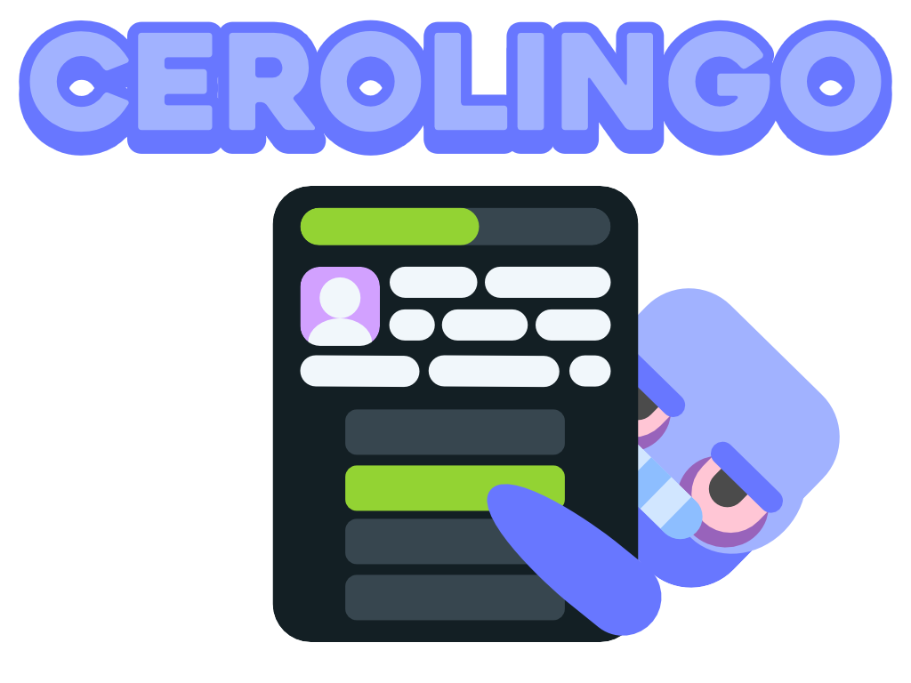

# Cerolingo

Duolingo answer automation tool ⚡  

## ✨ Features

- 🤖 **Auto Answer Bot:** Exclusive auto-answering built for Story Lessons.
- ⚡ **Point Exploit:** Gain points without having to complete lessons.
- 👑 **Legendary Bypass:** Works reliably on every level, anytime.
- 🔇 **Audio Blocking:** Instantly rejects audio playback requests so Duolingo skips talking lines and flies through story lessons fast.
- 🎛️ **All-in-One Mod Menu:** Control the extension, toggle modules, and change settings directly from the page.
- 🗺️ **Story Map Highlighting:** Auto-detects and custom-styles story nodes on your learning map with the Cerolingo theme.
- 📱 **Cross-Platform:** Full support for Chrome, desktop Firefox, and Firefox for Android mobile!
- 🌐 **Global Support:** Works seamlessly on both `duolingo.com` and `duolingo.cn`.

## 🎛️ Mod Menu

Cerolingo features an in-page mod menu redesigned with a unified dark theme overlaying directly on Duolingo. You can manage settings, toggle modules, and control the extension on the fly without ever opening your browser's extension popup.

- 👁️ **Hideable:** Double-click the title bar anytime to minimize or toggle the menu out of your way.
- 📲 **Mobile Friendly:** Smooth drag controls tailored for phone browsers, with page scrolling automatically disabled while dragging to prevent lag.

## 🔮 Upcoming Changes

- 🤫 Other Duolingo tweaks
