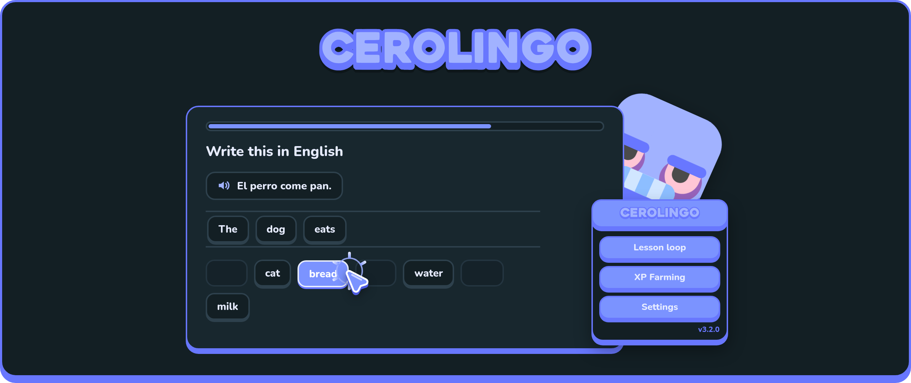

  
  
  

  
  &nbsp;
  

# Cerolingo Website

Official landing page and privacy policy site for **Cerolingo**, the free and open-source (GPLv3) Duolingo automation browser extension.

## Links

- [ancymon.dev/Cerolingo](https://ancymon.dev/Cerolingo/) - Main landing page, preview, and FAQ
- [ancymon.dev/Cerolingo/privacy](https://ancymon.dev/Cerolingo/privacy) - Extension privacy policy
- [Chrome Web Store](https://chromewebstore.google.com/detail/cerolingo/apgkphplddmjkoogmoijendkdjaaeiii) ([Leave a review](https://chromewebstore.google.com/detail/cerolingo/apgkphplddmjkoogmoijendkdjaaeiii/reviews))
- [Firefox Add-ons](https://addons.mozilla.org/firefox/addon/cerolingo/) ([Leave a review](https://addons.mozilla.org/firefox/addon/cerolingo/reviews/))
- [GitHub Repository](https://github.com/ancym0n/Cerolingo)

## CerolingoBM

Want to create Duolingo accounts in bulk, farm XP across a saved account list, or run headless browser sessions from a desktop app? Check out [CerolingoBM](https://ancymon.dev/CerolingoBM/) ([GitHub](https://github.com/ancym0n/CerolingoBM)) for Windows and Linux.
